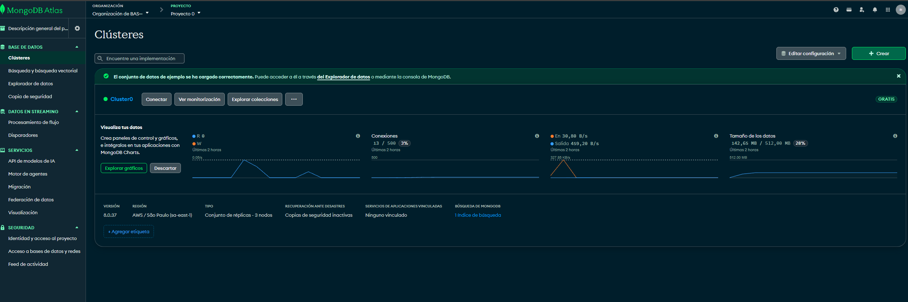
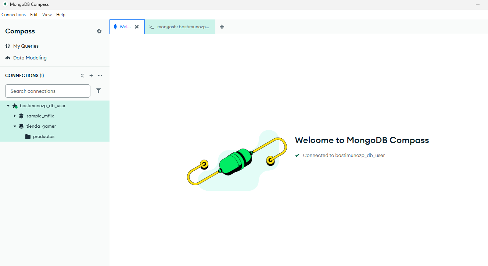
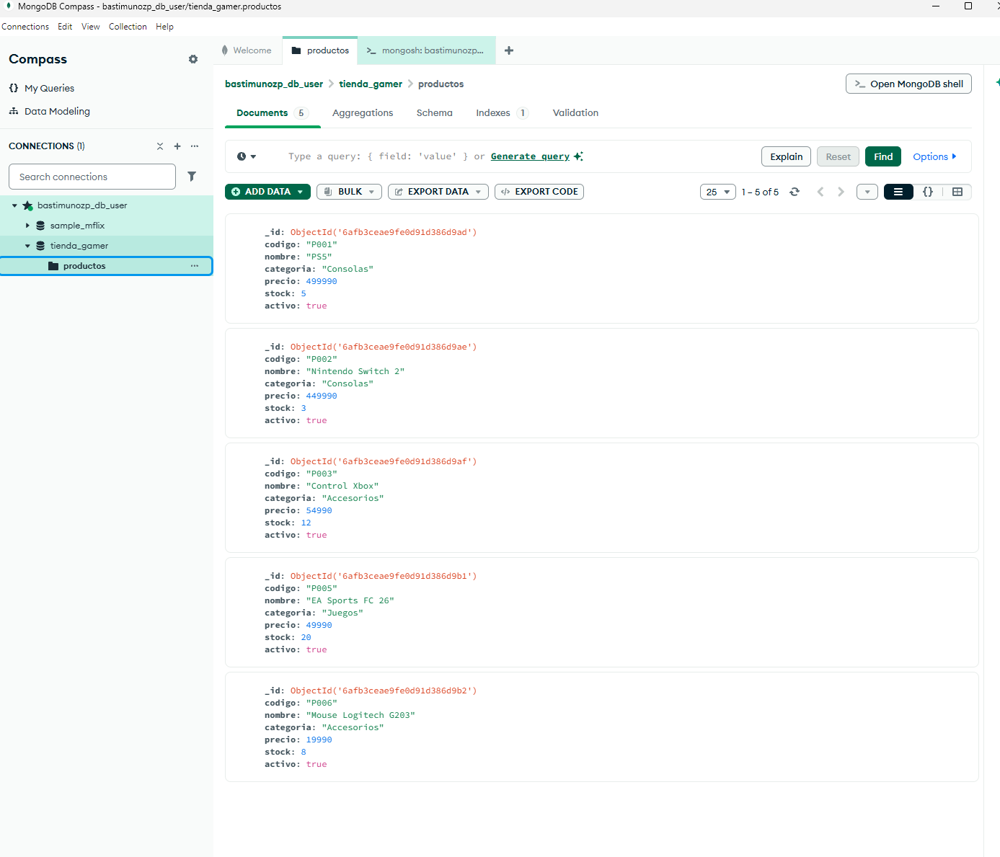
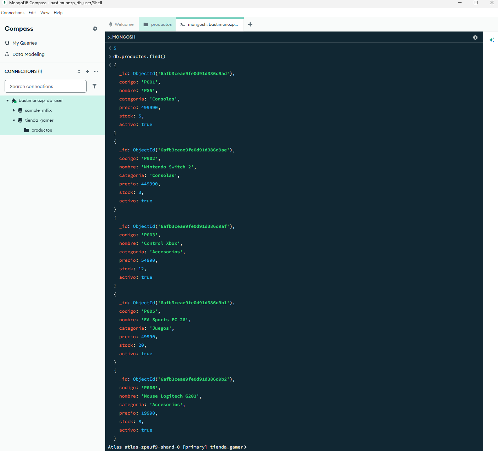
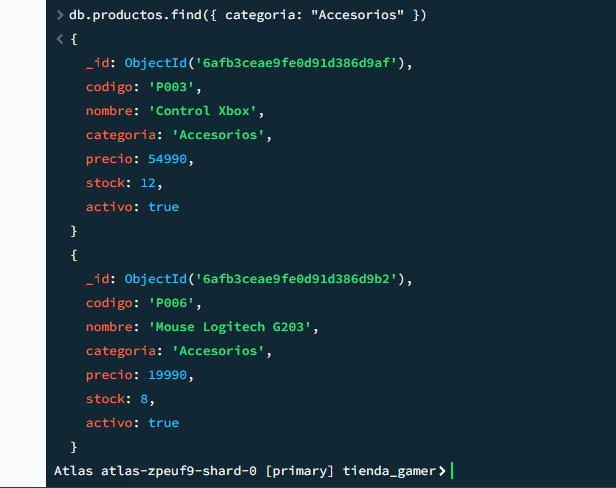
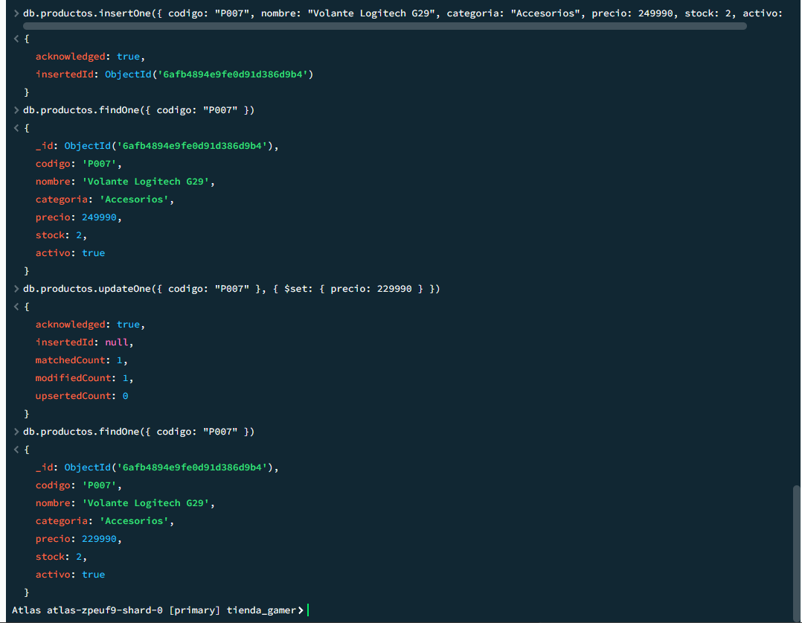
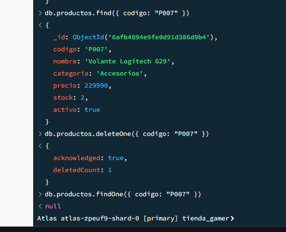

# CRUD en MongoDB – Tienda Gamer

CRUD completo (Create, Read, Update, Delete) sobre una base de datos NoSQL en **MongoDB Atlas**, gestionada con **MongoDB Compass** y **mongosh**.

Actividad de la asignatura *BDY1103 – Taller de Base de Datos* (Analista Programador, Duoc UC).

## Tecnologías

- MongoDB Atlas (clúster gratuito M0, AWS São Paulo)
- MongoDB Compass
- mongosh (MongoDB Shell)

## Modelo de datos

- **Base de datos:** `tienda_gamer`
- **Colección:** `productos`

| Campo | Tipo | Descripción |
|---|---|---|
| `_id` | ObjectId | Identificador único generado por MongoDB |
| `codigo` | String | Código interno del producto (ej. `P001`) |
| `nombre` | String | Nombre del producto |
| `categoria` | String | Consolas, Accesorios o Juegos |
| `precio` | Number | Precio en pesos chilenos |
| `stock` | Number | Unidades disponibles |
| `activo` | Boolean | Si el producto sigue a la venta |

```json
{
  "codigo": "P001",
  "nombre": "PS5",
  "categoria": "Consolas",
  "precio": 499990,
  "stock": 5,
  "activo": true
}
```

## Operaciones CRUD

| Operación | MongoDB | Equivalente SQL |
|---|---|---|
| Create | `db.productos.insertOne({...})` | `INSERT INTO productos ...` |
| Read | `db.productos.find({ categoria: "Accesorios" })` | `SELECT * FROM productos WHERE categoria = 'Accesorios'` |
| Update | `db.productos.updateOne({ codigo: "P003" }, { $set: { precio: 54990 } })` | `UPDATE productos SET precio = 54990 WHERE codigo = 'P003'` |
| Delete | `db.productos.deleteMany({ activo: false })` | `DELETE FROM productos WHERE activo = false` |

El script completo está en [`crud_tienda_gamer.js`](crud_tienda_gamer.js).

## Evidencias

### Clúster en Atlas


### Conexión desde Compass


### CREATE – documentos insertados


### READ – consulta general


### READ – consulta filtrada


### UPDATE – antes y después


### DELETE – antes y después


## Cómo ejecutarlo

1. Crear un clúster gratuito en MongoDB Atlas y un usuario de base de datos.
2. Autorizar tu IP en *Network Access*.
3. Conectar MongoDB Compass con la cadena de conexión de Atlas.
4. Abrir mongosh en Compass y ejecutar los comandos de `crud_tienda_gamer.js` uno por uno.

> La cadena de conexión y las credenciales no se incluyen en este repositorio.
